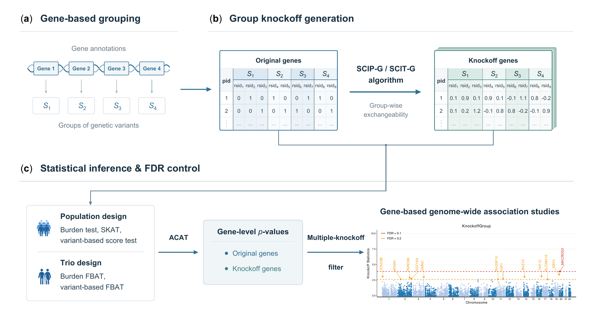

# KnockoffGroup: A gene-based group knockoff framework for genome-wide association studies

**KnockoffGroup** is a gene-based group knockoff framework for identifying putative causal genes in population-based and trio-based genome-wide association studies (GWAS). It defines variant groups using annotated gene boundaries and generates design-specific group knockoffs as negative controls. Gene-level association evidence is obtained by combining test p-values with the aggregated Cauchy association test (ACAT). The original and knockoff gene scores are then compared using a multiple-knockoff filter for gene selection at a target false discovery rate (FDR). By treating genes as the units of inference, KnockoffGroup connects variant-level signals to biologically interpretable discoveries and accommodates both unrelated individuals and parent-offspring trios.

This package provides functions to generate group knockoffs, calculate gene-level association statistics, and compute multiple-knockoff q-values.



---

## Repository Structure

- `R/create_knockoff.R`: Defines group knockoff generation.
    - `create_knockoff`: Generates multiple group knockoffs for population-based or trio-based studies.
- `R/knockoff_main.R`: Provides the main association-analysis interface.
    - `KnockoffGroup`: Runs gene-level association analysis for the selected study design.
- `R/knockoff_population.R`: Contains population-based association functions.
    - `KS.prelim`: Fits the null phenotype model, with optional covariate adjustment.
    - `KS.chr_ko`: Calculates original and knockoff gene-level association statistics for population data.
- `R/knockoff_trio.R`: Contains trio-based association functions.
    - `KnockoffGroup_trio`: Calculates family-based gene association statistics for original and knockoff data.
- `R/knockoff_qvalues.R`: Provides the multiple-knockoff filter.
    - `knockoff_qvalues`: Computes gene-level q-values from the knockoff statistics `kappa` and `tau`.
- `R/data.R`: Documents the example dataset.
- `data/KnockoffGroup.example.rda`: Contains synthetic genotypes, haplotypes, phenotypes, and gene annotations for the population and trio examples.
- `man/`: Contains R documentation files (`.Rd`) for the package functions and example data.

---

## Installation

You can install the development version of KnockoffGroup from GitHub:

```r
# Install devtools if needed
install.packages("devtools")

# Install KnockoffGroup from GitHub
devtools::install_github("Ennazhou/KnockoffGroup")
```

**Required Dependencies**:

- R (>= 3.5.0)
- `stats`, `Matrix`, `CompQuadForm`, `SPAtest`

---

## Application 1: Population-based analysis

This application illustrates gene-level analysis of unrelated individuals using genotype data and a binary or continuous phenotype. It proceeds from group knockoff generation to association testing and gene selection.

### Step 0. Load the package and toy data

```r
library(KnockoffGroup)
data("KnockoffGroup.example")
example <- KnockoffGroup.example
str(example, max.level = 1)
```

This dataset is generated entirely from random draws with seed `20261112`. It contains 12 variants assigned to three artificial genes, 180 unrelated population individuals, and a separate sample of 60 Mendelian trios. The generation script is `data-raw/generate_example.R`.

Variant columns, positions, and group labels must have the same order. Group labels index rows of `window_matrix`. The example's boundaries include all assigned variants under the population function's half-open interval convention, `start <= pos < end`.

### Step 1. Generate group knockoffs

Generate knockoffs jointly for the complete input feature matrix, then evaluate gene-level statistics using that generated array.

```r
M <- 10L
set.seed(101)
knockoffs.pop <- create_knockoff(
    window_matrix = example$window_matrix,
    gene.clusters = example$gene.clusters,
    dat = example$dat.pop,
    pos = example$pos,
    design = "population",
    M = M,
    cormin = 0.01,
    maxbp = 500000,
    maxN.neighbor = 60
)
dim(knockoffs.pop)
```

#### Arguments

- `dat` supplies the original genotype matrix with individuals in rows and variants in columns.
- `window_matrix`, `gene.clusters`, and `pos` describe the full feature system and its groups.
- `M` sets the number of knockoff copies.
- `cormin` sets the correlation threshold for eligible neighboring variants, and `maxbp` sets the positional neighborhood.
- `maxN.neighbor` limits the regression neighbors. The fast implementation also caps this count at the cube root of its input sample size.

#### Outputs

`knockoffs.pop` is a `180 × 12 × 10` numeric array. The third dimension indexes knockoff copies.

### Step 2. Fit the phenotype model and calculate gene statistics

```r
null.pop <- KS.prelim(Y = example$y.b, out_type = "D")
results.pop <- KnockoffGroup(
    design = "population",
    result.prelim = null.pop,
    chr = 1,
    dat_ko = knockoffs.pop,
    dat = example$dat.pop,
    pos = example$pos,
    window.bed = example$window.bed,
    M = M,
    thres.single = 0.01,
    thres.ultrarare = 0
)
head(results.pop$result.window)
```

#### Arguments

`KS.prelim()` uses `out_type = "D"` for binary outcomes and `out_type = "C"` for continuous outcomes. Its optional `X` argument supplies a covariate matrix whose rows match the genotype rows. `KnockoffGroup()` receives this fitted null model, the original and knockoff matrices, and the gene boundaries. Population windows are deduplicated by their variant memberships and require at least one variant and a total minor allele count of 10, matching the manuscript workflow.

#### Outputs

`results.pop` contains `result.single` and `result.window`. The gene-level table includes coordinates, `P_KS` for the original combined association p-value, `P_KS_k1` through `P_KS_k10` for knockoff p-values, `W_KS`, `kappa`, and `tau`. `kappa = 0` denotes an original-feature winner. `tau` is the difference between the largest importance score and the median of the remaining scores.

For a continuous outcome, refit the null model using `example$y.c` and pass it to the same association function.

```r
null.continuous <- KS.prelim(Y = example$y.c, out_type = "C")
```

### Step 3. Calculate q-values and select genes

Apply the filter to the complete collection of tested gene statistics. For a multi-chromosome analysis, combine the gene tables before this step.

```r
genes.pop <- as.data.frame(results.pop$result.window)
genes.pop$qvalue <- knockoff_qvalues(genes.pop$kappa, genes.pop$tau, M = M)
selected.pop <- genes.pop[genes.pop$qvalue <= 0.1, , drop = FALSE]
head(selected.pop)
```

#### Arguments

`kappa` and `tau` are matching vectors of gene statistics. `M` must equal the number of generated knockoff copies. `knockoff_qvalues()` evaluates the multiple-knockoff discovery ratio at each distinct positive `tau` threshold, including tied scores together.

#### Outputs

The q-value vector follows the input gene order. Knockoff winners, zero gaps, and missing statistics receive a q-value of 1. The selected set in this small demonstration can be empty.

---

## Application 2: Trio-based analysis

This application uses phased parental and offspring haplotypes to generate trio knockoffs, calculate family-based gene association statistics, and select genes using the multiple-knockoff filter.

### Step 0. Inspect the trio input

```r
dim(example$dat.hap)
dim(example$dat)
example$geneinfo
```

Each trio contributes six haplotype rows in father, mother, offspring order, with two haplotypes per individual. The offspring's first haplotype is paternal and the second is maternal. Every haplotype entry is 0 or 1. `dat` contains the corresponding sums of each pair of haplotypes. The synthetic trios illustrate input structure and execution.

### Step 1. Generate trio knockoffs

```r
set.seed(102)
knockoffs.trio <- create_knockoff(
    window_matrix = example$window_matrix,
    gene.clusters = example$gene.clusters,
    dat = example$dat.hap,
    pos = example$pos,
    design = "trio",
    M = M,
    cormin = 0.01,
    maxbp = 500000,
    maxN.neighbor = 60
)
dim(knockoffs.trio)
```

#### Arguments

`design = "trio"` selects the parental-haplotype construction. Optional `phasing.dad` and `phasing.mom` vectors specify the transmitted parental haplotypes. When omitted, the package determines them from the supplied trio haplotypes. The grouping and neighborhood arguments have the same roles as in Application 1.

#### Outputs

`knockoffs.trio` is a `180 × 12 × 10` genotype array in father, mother, offspring order.

### Step 2. Calculate gene-level association statistics

```r
genes.trio <- KnockoffGroup(
    design = "trio",
    geneinfo = example$geneinfo,
    dat = example$dat,
    dat.ko = knockoffs.trio,
    pos = example$pos,
    chr = "1"
)
head(genes.trio)
```

#### Arguments

`geneinfo` supplies each gene's boundaries and variant count. `dat`, `dat.ko`, and `pos` must describe matching variants in matching order. The function evaluates each gene using the jointly generated knockoff array. The default path uses the family-based association statistics. The optional quantitative-trait path accepts offspring residuals through `y` with `adjust_for_cov = TRUE`.

#### Outputs

`genes.trio` contains one row per gene with `p`, `z`, `p.burden`, `w`, `kappa`, and `tau`, together with the knockoff `p_1` through `p_10` and `z_1` through `z_10` columns. `p` is the combined association p-value used for the knockoff importance score.

### Step 3. Select genes

```r
genes.trio$qvalue <- knockoff_qvalues(genes.trio$kappa, genes.trio$tau, M = M)
selected.trio <- genes.trio[genes.trio$qvalue <= 0.1, , drop = FALSE]
head(selected.trio)
```

The q-value calculation uses the full tested gene set and the same `M` as the generation step.

---

## Contact

For questions, contact Yue Zhou at yue.zhou@my.cityu.edu.hk or open an issue in the package repository.
